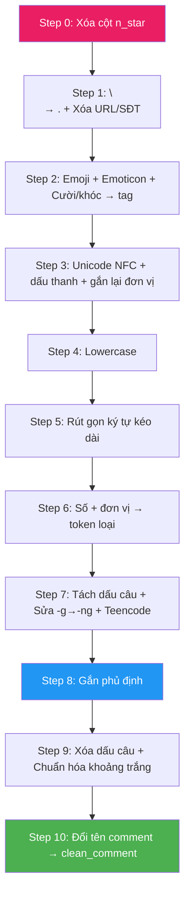

# Data Cleaning Pipeline — Steps & Rules

## Schema dữ liệu

### Input (CSV gốc — `Train.csv`, `Dev.csv`)

| Cột | Kiểu | Ví dụ |
|:---|:---|:---|
| `index` | int | `0` |
| `comment` | str | `"Mới mua máy này Tại thegioididong thật nật cảm thấy ok bin trâu chụp ảnh đẹp..."` |
| `n_star` | int | `5` |
| `date_time` | str | `"2 tuần trước"` |
| `label` | str | `"{CAMERA#Positive};{BATTERY#Positive};{PRICE#Positive};"` |

### Output (sau khi clean)

| Cột | Kiểu | Mô tả |
|:---|:---|:---|
| `index` | int | Giữ nguyên |
| `clean_comment` | str | Text đã qua toàn bộ 9 bước cleaning |
| `date_time` | str | Giữ nguyên |
| `label` | str | Giữ nguyên |

> [!IMPORTANT]
> Cột `n_star` bị **xóa** (Step 0). Cột `comment` bị **thay thế** bằng `clean_comment` (Step 10).

---

## RULES chung (áp dụng cho toàn bộ pipeline)

### RULE 1 — Phạm vi tác động
Chỉ **Step 0** thao tác ở cấp cột (xóa `n_star`). Các Steps 1–9 **chỉ** thay đổi value bên trong cột `comment`, **không** đụng đến `index`, `date_time`, `label`. Step 10 đổi tên cột.

### RULE 2 — Thứ tự thực thi bắt buộc
Các step phải chạy **tuần tự theo đúng thứ tự** 0 → 1 → 2 → ... → 10. Đổi thứ tự sẽ gây sai logic (xem ràng buộc phụ thuộc bên dưới).

### RULE 3 — Stateless (không học từ dữ liệu)
Mọi luật và từ điển đều cố định, **không fit** trên dữ liệu. Pipeline áp dụng giống hệt cho train, dev, test và bình luận mới khi triển khai.

### RULE 4 — Giữ nguyên số dòng
Không xóa, không thêm, không tách dòng. Số dòng output = số dòng input.

### RULE 5 — Xử lý giá trị rỗng
Nếu `comment` là `NaN` hoặc chuỗi rỗng → gán `""` (chuỗi rỗng) và cho qua mọi step mà không lỗi.

---

## Các bước thực hiện

---

### Step 0 — Xóa cột `n_star`

**Input:** DataFrame gốc với 5 cột `[index, comment, n_star, date_time, label]`

**Xử lý:** `df = df.drop(columns=["n_star"])`

**Output:** DataFrame còn 4 cột `[index, comment, date_time, label]`

**Lý do:**
- `n_star` (số sao đánh giá) là **label tổng hợp** do người dùng chấm, không phải đặc trưng văn bản
- Nếu giữ lại và dùng làm feature, mô hình sẽ "ăn gian" (data leakage) — biết trước người dùng hài lòng hay không mà không cần đọc comment
- Bài toán ABSA yêu cầu trích xuất khía cạnh + cảm xúc **từ nội dung văn bản**, không từ metadata

**RULE Step 0:** Chỉ xóa cột, không thay đổi bất kỳ giá trị nào.

---

### Step 1 — Đánh dấu ranh giới câu + Dọn rác hệ thống

**Xử lý trên cột `comment`:**

```
comment = mark_line_breaks(comment)     # "\n" → " . "
comment = remove_urls_emails(comment)   # Xóa URL, email, SĐT
```

**Ví dụ:**
```
Input:  "pin ko\ncam chụp đẹp. LH 0912345678"
Output: "pin ko . cam chụp đẹp.  "
```

**RULE Step 1:**
- Mọi ký tự `\r\n`, `\n` → ` . ` (dấu chấm bao quanh bởi khoảng trắng)
- Regex xóa URL (`https?://...`, `www.`...), email (`xxx@xxx.xxx`), SĐT (`0xxxxxxxxx`, `+84...`)
- **Không** xóa bất kỳ từ nào khác

**Tại sao phải Step đầu tiên:**
- 11.5% bình luận train dùng xuống dòng thay dấu câu → tạo ranh giới câu bằng `.` để Step 8 (gắn phủ định) không nhảy sang câu sau
- URL/SĐT tạo token duy nhất (DF = 1), chỉ thêm nhiễu

---

### Step 2 — Gom Emoji, Emoticon, Chuỗi cười/khóc → Nhãn cảm xúc

**Xử lý trên cột `comment`:**

```
comment = replace_emojis(comment, mode="tag")       # 👍😡 → emopos/emoneg
comment = replace_emoticons(comment, mode="tag")    # :)) T_T → emopos/emoneg
comment = replace_laughter(comment, mode="tag")     # hahaha kkkk → emopos; huhu → emoneg
```

**Ví dụ:**
```
Input:  "Pin trâu 👍👍 kkkkk ngon :))"
Output: "Pin trâu  emopos   emopos  ngon  emopos "
```

**RULE Step 2:**
- Emoji Unicode → tra bảng ghi đè; nếu không có → suy luận từ tên Unicode (`SMILING` → `emopos`, `CRYING` → `emoneg`, `THINKING` → `emoneu`); nếu không rõ → xóa
- Emoticon ASCII (`:))`, `=))`, `<3`, `^^` → `emopos`; `:(`, `T_T`, `>_<` → `emoneg`; `:v`, `:o` → `emoneu`). Regex dùng lookaround tránh bắt nhầm giờ `8:30`
- Chuỗi cười chữ: `hahaha|hihi|kkkk` → `emopos`; khóc/thở dài: `huhu|hic|haizzz` → `emoneg`
- Gộp lặp liên tiếp: `emopos emopos emopos` → `emopos`
- **Phải chạy TRƯỚC Step 5** (rút gọn ký tự lặp): nếu không, `kkkk` → (rút gọn) → `k` → (teencode) → `không` — **sai nghĩa 180°**
- **Phải chạy TRƯỚC Step 4** (lowercase): `:D` (hoa) cần giữ nguyên để regex nhận diện emoticon

---

### Step 3 — Chuẩn hóa Unicode NFC + Dấu thanh + Gắn lại đơn vị

**Xử lý trên cột `comment`:**

```
comment = normalize_unicode(comment)      # NFC + hoà → hòa, thuỷ → thủy
comment = rejoin_number_units(comment)    # "250 k" → "250k"
```

**Ví dụ:**
```
Input:  "Pin hoà nhã, giá 250 k"
Output: "Pin hòa nhã, giá 250k"
```

**RULE Step 3:**
- Áp dụng `unicodedata.normalize("NFC", text)`
- Xóa ký tự vô hình (zero-width space, BOM,...)
- Chuẩn dấu thanh tiếng Việt về kiểu mới (`hoà` → `hòa`) bằng `underthesea.text_normalize` nếu có
- Gắn lại đơn vị bị tách: `250 k` → `250k`, `5000 mAh` → `5000mAh` (tránh `k` bị teencode hiểu nhầm thành `không`)

---

### Step 4 — Lowercase

**Xử lý trên cột `comment`:**

```
comment = comment.lower()
```

**Ví dụ:**
```
Input:  "Pin hòa nhã CAMERA tốt"
Output: "pin hòa nhã camera tốt"
```

**RULE Step 4:**
- Chuyển toàn bộ về chữ thường
- **Phải chạy SAU Step 2**: emoticon `:D` (hoa) cần nhận diện trước khi lowercase

---

### Step 5 — Rút gọn ký tự kéo dài

**Xử lý trên cột `comment`:**

```
comment = reduce_elongation(comment)
```

**Ví dụ:**
```
Input:  "đẹppppp quá rồiii good"
Output: "đẹp quá rồi good"
```

**RULE Step 5:**
- Chữ cái lặp ≥ 3 lần liên tiếp → rút về 1: `đẹppppp` → `đẹp`, `okkk` → `ok`
- Chữ cái lặp đôi ở **cuối token** → rút về 1 **chỉ khi** token có dấu tiếng Việt: `rồiii` → `rồi`
- **Giữ nguyên** từ tiếng Anh hợp lệ: `good`, `full`, `lagg` không bị đụng
- **Phải chạy SAU Step 2**: nếu không, `kkkk` → `k` trước khi kịp nhận diện là chuỗi cười

---

### Step 6 — Chuẩn hóa số + đơn vị → Token loại khía cạnh

**Xử lý trên cột `comment`:**

```
comment = normalize_numbers(comment)
```

**Ví dụ:**
```
Input:  "pin 5000mah giá 7tr5 ram 128gb cam 48mp màn 120hz dùng 2 tháng galaxy a51"
Output: "pin  numbattery  giá  numprice  ram  numstorage  cam  numcamera  màn  numfreq  dùng  numduration  galaxy a51"
```

**RULE Step 6:**
- Áp dụng regex theo **thứ tự cụ thể trước chung**: date → time → price → battery → storage → camera → freq → power → percent → size → duration → num (chung)
- Mã model dính liền chữ+số (`a51`, `s20`, `j7`) **không bị bắt** (regex yêu cầu số đứng riêng)
- **Phải chạy SAU Step 4** (lowercase): `mAh` → `mah` → khớp regex
- **Phải chạy SAU Step 3**: đơn vị đã được gắn lại (`250k` thay vì `250 k`)

---

### Step 7 — Sửa chính tả `-g` → `-ng` + Khai triển Teencode/Viết tắt

**Xử lý trên cột `comment`:**

```
comment = normalize_punctuation(comment, remove=False)  # TÁCH dấu câu thành token riêng
comment = restore_final_ng(comment)                      # khôg → không
comment = TeencodeNormalizer(teencode_dict)(comment)      # ko → không, đt → điện thoại
comment = normalize_whitespace(comment)                  # gộp khoảng trắng
```

**Ví dụ:**
```
Input:  "khôg dc đt này,sp kém"
    → (tách dấu câu)  "khôg dc đt này , sp kém"
    → (sửa -g→-ng)    "không dc đt này , sp kém"
    → (teencode)       "không được điện thoại này , sản phẩm kém"
```

**RULE Step 7:**
- **Tách dấu câu trước** (không xóa): `tốt,pin` → `tốt , pin`; gộp dấu lặp `!!!` → `!`; giữ số có dấu `7.990.000`. Mục đích: để `k,` tách thành `k ,` → `k` khớp teencode
- Sửa `-g` → `-ng`: chỉ áp dụng cho token **có dấu tiếng Việt** và kết thúc bằng nguyên_âm + g (`khôg` → `không`, `đag` → `đang`). **Không đụng** từ tiếng Anh: `lag`, `bag`, `tag`
- Teencode: tra từ điển 345 mục, khớp **nguyên token** (không thay chuỗi con): `k` → `không`, `dc` → `được`, `đt` → `điện thoại`. Cụm nhiều từ (`cũng z` → `cũng vậy`) được thay trước bằng regex có ranh giới từ
- **Phải chạy SAU Step 5**: rút gọn `okkk` → `ok` trước, rồi mới tra teencode

---

### Step 8 — Gắn từ phủ định

**Xử lý trên cột `comment`:**

```
comment = attach_negation(comment.split(), negation_words, window=1)
comment = " ".join(comment)
```

**Ví dụ:**
```
Input:  "không được điện thoại này , sản phẩm kém . pin trâu"
Output: "không_được_điện thoại này , sản phẩm kém . pin trâu"
    → "không" gắn "được" (từ đệm) + "điện" (1 token nội dung), dừng
```

Ví dụ ranh giới câu:
```
Input:  "pin không . cam đẹp"
Output: "pin không . cam đẹp"
    → Dấu "." chặn phủ định, "cam" KHÔNG bị nối
```

**RULE Step 8:**
- Gắn từ phủ định (`không`, `chưa`, `chẳng`, `đừng`,...) với **tối đa 1 token nội dung** đứng sau, nối bằng `_`
- Từ đệm (`được`, `hề`, `có`, `phải`, `bị`, `quá`, `lắm`, `mấy`, `thể`, `còn`, `thấy`) được gộp thêm mà **không tính** vào window
- **Dừng ngay** khi gặp:
  - Token dấu câu (`. , ? ! ; : -` ...) → ranh giới câu
  - Một từ phủ định khác → phủ định kép: `không không tốt` → `không`, `không_tốt`
- **ĐIỀU KIỆN TIÊN QUYẾT bắt buộc** (thiếu 1 là sai):
  1. Dấu câu phải đã được **tách** thành token riêng (Step 7) nhưng **chưa xóa**
  2. Xuống dòng phải đã đổi thành `.` (Step 1)
  3. Teencode phải đã khai triển (Step 7): `ko` → `không` để regex phủ định nhận diện

---

### Step 9 — Xóa dấu câu + Chuẩn hóa khoảng trắng cuối

**Xử lý trên cột `comment`:**

```
comment = normalize_punctuation(comment, remove=True)   # xóa mọi ký tự không phải chữ/số
comment = normalize_whitespace(comment)                 # gộp khoảng trắng, cắt 2 đầu
```

**Ví dụ:**
```
Input:  "không_được_điện thoại này , sản phẩm kém . pin trâu !"
Output: "không_được_điện thoại này sản phẩm kém pin trâu"
```

**RULE Step 9:**
- Xóa **mọi** ký tự không phải chữ cái, chữ số, `_` (bao gồm `.`, `,`, `?`, `!`, `;`, `:`, `-`, `(`, `)`,...)
- **Phải chạy SAU Step 8**: nếu xóa dấu câu trước khi gắn phủ định, phủ định sẽ nhảy qua ranh giới câu
- Stopword: **TẮT mặc định**. TF-IDF với `max_df=0.95` đã tự giảm trọng số từ phổ biến. Danh sách stopword tiếng Việt chứa `rất`, `quá`, `chưa`, `nhưng`, `được` — xóa sẽ mất tín hiệu cảm xúc/khía cạnh

---

### Step 10 — Đổi tên cột `comment` → `clean_comment`

**Xử lý:**

```
df = df.rename(columns={"comment": "clean_comment"})
```

**Output cuối cùng:** DataFrame 4 cột `[index, clean_comment, date_time, label]`

**Ví dụ end-to-end:**
```
comment (gốc):  "Mới mua máy này👍, ko lag\ncam chụp đẹp 48mp, giá 7tr5"
clean_comment:   "mới mua máy này emopos không_lag cam chụp đẹp numcamera giá numprice"
```

---

## Tóm tắt toàn bộ Pipeline



| Step | Thao tác | Cấp tác động | Phụ thuộc |
|:--:|:--|:--:|:--:|
| 0 | Xóa cột `n_star` | **Cột** | — |
| 1 | `\n` → `.` + Xóa URL/SĐT | Value `comment` | — |
| 2 | Emoji + Emoticon + Cười/khóc → tag | Value `comment` | Trước 4, 5 |
| 3 | Unicode NFC + dấu thanh + gắn lại đơn vị | Value `comment` | — |
| 4 | Lowercase | Value `comment` | Sau 2 |
| 5 | Rút gọn ký tự kéo dài | Value `comment` | Sau 2 |
| 6 | Số + đơn vị → token loại | Value `comment` | Sau 3, 4 |
| 7 | Tách dấu câu + `-g`→`-ng` + Teencode | Value `comment` | Sau 5 |
| 8 | Gắn phủ định | Value `comment` | Sau 1, 7 |
| 9 | Xóa dấu câu + Chuẩn hóa khoảng trắng | Value `comment` | Sau 8 |
| 10 | Đổi tên `comment` → `clean_comment` | **Cột** | Sau 9 |
