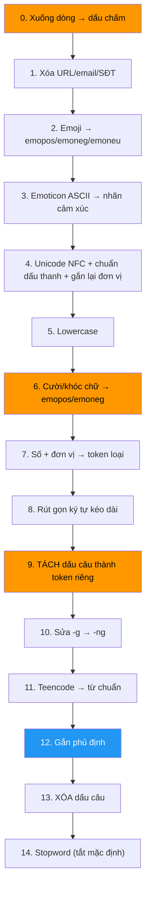

# So sánh bảng 9 bước với Pipeline code & Tổng hợp Pipeline tối ưu cho TF-IDF

## 1. Bảng gốc của bạn (9 bước)


---

## 2. Đối chiếu chi tiết: Bảng 9 bước ↔ Code pipeline (`src/absa/preprocessing/`)

| Bảng 9 bước | Code pipeline (15 sub-steps thực tế) | Nhận xét & Gap |
|:---|:---|:---|
| **Bước 1** — Unicode NFC & Lowercase | ✅ `normalize_unicode` (bước 4) + `lowercase` (bước 5) | **Khớp.** Code thêm chuẩn dấu thanh (`hoà` → `hòa`) và gắn lại đơn vị bị tách (`250 k` → `250k`) — bảng chưa đề cập chi tiết |
| **Bước 2** — Dọn rác hệ thống (URL, email, SĐT) | ✅ `remove_urls` (bước 1) | **Khớp.** |
| **Bước 3** — Rút gọn ký tự lặp kéo dài | ✅ `reduce_elongation` (bước 8) | **Khớp.** Code có thêm luật không rút từ tiếng Anh (`good`, `full`) — bảng ghi `lag` nhưng chưa nói rõ cơ chế bảo vệ |
| **Bước 4** — Gom nhóm Emoji & Emoticon | ✅ `replace_emojis` (bước 2) + `replace_emoticons` (bước 3) + `replace_laughter` (bước 6) | **Bảng thiếu bước 6** — chuỗi cười/khóc viết bằng chữ (`hahaha`, `kkkk`, `huhu`, `haizzz`) cũng cần gom thành `emopos`/`emoneg`. Nếu bỏ qua, `kkkk` sẽ bị bước 3 rút thành `k` → bước 5 dịch thành `không` (**sai nghĩa**) |
| **Bước 5** — Khôi phục Teencode & Viết tắt | ✅ `TeencodeNormalizer` (bước 11) + `restore_final_ng` (bước 10) | **Khớp.** Code tách rõ 2 sub-step: sửa `-g` → `-ng` trước, rồi mới tra teencode — bảng gộp lại nhưng ý tưởng giống |
| **Bước 6** — Chuẩn hóa thực thể số liệu & Phần cứng | ✅ `normalize_numbers` (bước 7) | **Khớp.** Code thêm token `numfreq`, `numpower`, `numpercent`, `numduration`, `numdate`, `numtime`, `numg` — bảng chỉ liệt kê `numbattery`, `numprice`, `numstorage` |
| **Bước 7** — Gắn từ phủ định | ✅ `attach_negation` (bước 12) | **Khớp ý tưởng, nhưng bảng chưa nhấn mạnh điều kiện tiên quyết quan trọng nhất**: phải chạy khi dấu câu còn là token riêng (chưa xóa) và không vượt ranh giới câu |
| **Bước 8** — Lọc dấu câu & Loại bỏ từ dừng an toàn | ✅ `remove_punctuation` (bước 13) + `remove_stopwords` (bước 14, tắt mặc định) | **Khớp.** Code tắt stopword mặc định vì TF-IDF `max_df=0.95` đã tự giảm trọng số |
| **Bước 9** — Phân rã âm tiết tự nhiên (không CRF) | ✅ Không tách từ, giữ mức âm tiết | **Khớp.** Đây là quyết định thiết kế cốt lõi có bằng chứng ablation |
| *(Bảng thiếu)* — Xuống dòng → dấu chấm | ✅ `mark_line_breaks` (bước 0) | **Bảng thiếu hoàn toàn.** 11.5% bình luận train dùng xuống dòng thay dấu câu — nếu bỏ qua, phủ định sẽ vượt qua ranh giới câu |
| *(Bảng thiếu)* — Tách dấu câu (trước gắn phủ định) | ✅ `normalize_punctuation(remove=False)` (bước 9) | **Bảng thiếu.** Dấu câu dính liền từ (`tốt,pin`) làm teencode không khớp (`k,` ≠ `k`); cần tách thành token riêng trước khi gắn phủ định |
| *(Bảng thiếu)* — Chuẩn hóa khoảng trắng | ✅ `normalize_whitespace` (bước cuối) | Chi tiết kỹ thuật nhỏ nhưng cần thiết |

---

## 3. Phân tích Gap — Bảng 9 bước còn thiếu gì cho TF-IDF?

> [!IMPORTANT]
> ### Ba lỗ hổng chính ảnh hưởng trực tiếp đến chất lượng TF-IDF

### Gap 1: Thiếu bước `mark_line_breaks` (xuống dòng → ranh giới câu)

```
Input:  "pin ko\ncam chụp đẹp"
```

| Có `mark_line_breaks` | Không có |
|:---|:---|
| `pin ko . cam chụp đẹp` → `pin không . cam chụp đẹp` → `pin không cam chụp đẹp` | `pin ko cam chụp đẹp` → `pin không_cam chụp đẹp` |
| ✅ `không` đứng riêng, `cam` giữ nguyên ý nghĩa | ❌ `không_cam` — TF-IDF học sai: camera bị phủ định |

**Tác động**: 11.5% bình luận train bị ảnh hưởng.

### Gap 2: Thiếu bước `replace_laughter` (chuỗi cười/khóc/thở dài bằng chữ)

```
Input:  "mượt kkkkk"
```

| Có `replace_laughter` trước `reduce_elongation` | Không có |
|:---|:---|
| `mượt kkkkk` → `mượt emopos` → `mượt emopos` | `mượt kkkkk` → `mượt k` → `mượt không` |
| ✅ TF-IDF nhận `emopos` = cảm xúc tích cực | ❌ TF-IDF nhận `không` = phủ định, sai nghĩa hoàn toàn |

**Tác động**: Sai nghĩa 180°, biến Positive thành Negative.

### Gap 3: Thiếu bước tách dấu câu thành token riêng (trước gắn phủ định)

```
Input:  "không tốt. pin trâu"
```

| Có tách dấu câu trước | Không có |
|:---|:---|
| `không tốt . pin trâu` → `không_tốt . pin trâu` → `không_tốt pin trâu` | `không tốt. pin trâu` → `không_tốt.` hoặc phủ định nhảy sang `pin` |
| ✅ Dấu `.` chặn phạm vi phủ định chính xác | ❌ Dấu câu dính từ, ranh giới mất hiệu lực |

---

## 4. Thứ tự thực thi — Tại sao quan trọng cho TF-IDF?

> [!WARNING]
> Với BoW/TF-IDF, **thứ tự các bước quyết định token cuối cùng** trong từ điển đặc trưng. Đổi thứ tự = thay đổi ma trận đặc trưng = thay đổi kết quả phân loại. Bảng 9 bước đánh số nhưng thứ tự chưa tối ưu.

### Ràng buộc thứ tự bắt buộc (dependency chain):



**Các ràng buộc then chốt:**
- **Bước 6 phải trước Bước 8**: `kkkk` → `emopos` trước khi rút gọn, nếu không `kkkk` → `k` → `không`
- **Bước 9 (TÁCH) phải trước Bước 12**: dấu câu phải là token riêng để chặn phạm vi phủ định
- **Bước 12 phải trước Bước 13 (XÓA)**: gắn phủ định xong rồi mới xóa dấu câu
- **Bước 0 phải đầu tiên**: xuống dòng → `.` tạo ranh giới câu cho bước 12

---

## 5. ✅ Pipeline tổng hợp tối ưu cho TF-IDF (10 bước)

> [!TIP]
> Pipeline dưới đây gộp lại từ 15 sub-steps trong code thành **10 bước logic** đã tối ưu, bổ sung 3 bước bảng thiếu, giữ đúng thứ tự ràng buộc.

### Bước 1 — Ranh giới câu & Dọn rác (`line_breaks` + `remove_urls`)

**Mục đích cho TF-IDF:** Tạo ranh giới câu từ ký tự xuống dòng (11.5% bình luận) và loại bỏ URL/email/SĐT không mang thông tin khía cạnh (DF ≈ 1, chỉ tạo nhiễu).

```
"Máy tốt\ncam xịn. Liên hệ 0912345678" → "Máy tốt . cam xịn . Liên hệ"
```

**Tại sao TF-IDF cần:** Xuống dòng tạo ranh giới câu bằng `.` để bước gắn phủ định (Bước 7) không nhảy sang câu sau. URL/SĐT tạo token duy nhất (DF = 1) bị `min_df=2` loại nhưng vẫn chiếm chỗ trong quá trình xử lý.

---

### Bước 2 — Gom Emoji, Emoticon, Cười/Khóc chữ → 3 siêu đặc trưng (`emopos`, `emoneg`, `emoneu`)

**Mục đích cho TF-IDF:** Thu nạp toàn bộ tín hiệu cảm xúc phi văn bản vào không gian TF-IDF.

```
"Pin trâu 👍👍 kkkkk"  → "Pin trâu emopos emopos"
"Chán T_T huhu"         → "Chán emoneg emoneg"
```

> [!CAUTION]
> **Bắt buộc** xử lý cười/khóc chữ (`kkkk`, `hahaha`, `huhu`, `haizzz`) **ở bước này**, TRƯỚC khi rút gọn ký tự kéo dài (Bước 5). Nếu không: `kkkk` → (rút gọn) → `k` → (teencode) → `không` — **đảo ngược cảm xúc hoàn toàn**.

**Chi tiết kỹ thuật:**
- Emoji Unicode: suy luận nhóm cảm xúc từ tên Unicode ký tự (`SMILING` → pos, `CRYING` → neg) + bảng ghi đè cho emoji phổ biến → gom hàng trăm emoji về 3 token
- Emoticon ASCII (`:))`, `T_T`, `<3`, `:v`): regex có lookaround tránh bắt nhầm giờ `8:30`
- Chuỗi cười/khóc chữ: `hahaha|hihi|kkkk` → `emopos`; `huhu|hic|haizzz` → `emoneg`
- Gộp lặp: `emopos emopos emopos` → `emopos`

**Tại sao TF-IDF cần:** Hàng trăm emoji/emoticon khác nhau (mỗi cái DF ≈ vài chục) bị phân mảnh trong không gian đặc trưng. Gom về 3 nhãn tạo ra 3 feature có DF cao và lực phân cực rất mạnh.

---

### Bước 3 — Unicode NFC + Chuẩn dấu thanh + Gắn lại đơn vị (`normalize_unicode` + `rejoin_number_units`)

**Mục đích cho TF-IDF:** Thống nhất biểu diễn ký tự, tránh cùng một từ tạo ra 2 cột khác nhau.

```
"hoà"     → "hòa"        (chuẩn kiểu bỏ dấu)
"250 k"   → "250k"        (gắn lại đơn vị bị tách)
```

**Tại sao TF-IDF cần:** 3.1% bình luận có dạng Unicode không chuẩn. `hoà` và `hòa` sẽ tạo 2 cột riêng trong ma trận TF-IDF, chia đôi tần suất. Gắn lại đơn vị (`250 k` → `250k`) tránh `k` bị teencode hiểu nhầm thành `không`.

---

### Bước 4 — Lowercase

```
"CAMERA Tốt" → "camera tốt"
```

**Tại sao TF-IDF cần:** `Camera`, `CAMERA`, `camera` phải là cùng một feature. Chạy sau emoji/emoticon vì `:D` (hoa) cần giữ nguyên khi nhận diện emoticon.

---

### Bước 5 — Rút gọn ký tự kéo dài (`reduce_elongation`)

**Mục đích cho TF-IDF:** Gom các biến thể nhấn mạnh về dạng chuẩn, tăng tần suất (TF) của từ gốc.

```
"đẹppppp" → "đẹp"    (lặp ≥3 → 1)
"rồiii"   → "rồi"    (lặp đôi cuối + có dấu tiếng Việt → rút)
"good"    → "good"   (tiếng Anh → giữ nguyên)
```

**Tại sao TF-IDF cần:** `đẹppppp`, `đẹpp`, `đẹp` là 3 token khác nhau nếu không rút gọn. Gom lại tăng DF của `đẹp`, giúp IDF phản ánh đúng mức quan trọng. Luật dựa trên chính tả tiếng Việt (không bao giờ có 3 chữ cái giống nhau liên tiếp), bảo vệ từ tiếng Anh.

---

### Bước 6 — Chuẩn hóa số + đơn vị → Token khía cạnh (`normalize_numbers`)

**Mục đích cho TF-IDF:** Tạo tín hiệu nhận diện khía cạnh cực mạnh từ 62.5% bình luận có chữ số.

```
"5000mah"     → "numbattery"     (→ khía cạnh BATTERY)
"7tr5"        → "numprice"       (→ khía cạnh PRICE)
"128gb"       → "numstorage"     (→ khía cạnh STORAGE)
"48mp"        → "numcamera"      (→ khía cạnh CAMERA)
"120hz"       → "numfreq"        (→ khía cạnh SCREEN/PERFORMANCE)
"2 tháng"     → "numduration"    (→ khía cạnh SERVICE/WARRANTY)
"8/3/2019"    → "numdate"
"galaxy a51"  → "galaxy a51"     (mã model KHÔNG bị đụng)
```

**Tại sao TF-IDF cần:** Pipeline refs xóa toàn bộ số → mất tín hiệu quan trọng nhất cho nhận diện khía cạnh. Pipeline này **giữ lại thông tin bằng cách gom về token loại**, tạo ra feature có DF cao và tương quan cực mạnh với nhãn khía cạnh. Mã model (`a51`, `s20`) có chữ dính liền số nên không bị regex bắt.

---

### Bước 7 — Sửa chính tả `-g` → `-ng` + Teencode/Viết tắt → Từ chuẩn

**Mục đích cho TF-IDF:** Thu gọn từ vựng, gom các biến thể viết tắt về token chuẩn, tăng DF.

```
"khôg"  → "không"     (luật chính tả: âm tiết VN không kết thúc nguyên_âm+g)
"ko"    → "không"     (từ điển teencode 345 mục, domain điện thoại)
"đt"    → "điện thoại"
"sp"    → "sản phẩm"
"kém"   → "kém"       (khớp nguyên token, không thay chuỗi con)
```

> [!NOTE]
> **Thứ tự quan trọng**: sửa `-g` → `-ng` **trước** teencode. Nếu không, `khôg` không khớp mục `không` trong từ điển vì `khôg ≠ không`.
>
> **Phải chạy SAU bước tách dấu câu**: `k,` (dấu phẩy dính) → tách thành `k ,` → `k` khớp teencode → `không`. Nếu teencode chạy trước tách dấu câu, `k,` không khớp mục `k`.

**Tại sao TF-IDF cần:** Nếu `ko`, `k`, `khg`, `khôg`, `không` là 5 cột khác nhau, mỗi cột có DF thấp → IDF cao giả → trọng số sai lệch. Gom về `không` tăng DF lên đúng mức, IDF phản ánh chính xác.

---

### Bước 8 — Gắn từ phủ định (`attach_negation`)

**Mục đích cho TF-IDF:** Giải quyết nhược điểm "mù trật tự từ" — **bước sống còn duy nhất** cho mô hình túi-từ.

```
"không mượt"           → "không_mượt"           (1 token phủ định)
"không được mượt"      → "không_được_mượt"      (từ đệm được gộp thêm)
"không . cam"          → "không . cam"           (dấu câu = ranh giới, KHÔNG nối)
"không không tốt"      → "không không_tốt"       (phủ định kép, KHÔNG gộp thành 1 khối)
```

> [!IMPORTANT]
> **Điều kiện tiên quyết bắt buộc — thiếu 1 là sai:**
> 1. Dấu câu phải đã được **tách** thành token riêng (bước trước) nhưng **chưa xóa**
> 2. Xuống dòng phải đã được đổi thành `.` (Bước 1)
> 3. Teencode phải đã được khai triển (Bước 7): `ko` → `không` để regex phủ định nhận diện
>
> Nếu thiếu bất kỳ điều kiện nào, phủ định sẽ nhảy sang câu sau hoặc bỏ sót.

**Tại sao TF-IDF cần:** TF-IDF hoàn toàn không thấy thứ tự từ. `không mượt` = {`không`: 1, `mượt`: 1} — cùng features với `mượt, không cần lo`. Token `không_mượt` tạo feature mới có trọng số **ngược dấu** với `mượt`, cho phép mô hình tuyến tính (LR, SVM) phân biệt chính xác.

*Tham khảo: Das & Chen (2001), Pang et al. (2002) — negation scope marking.*

---

### Bước 9 — Xóa dấu câu + Stopword (tùy chọn) + Chuẩn hóa khoảng trắng

**Mục đích cho TF-IDF:** Loại bỏ token không mang thông tin khía cạnh/cảm xúc sau khi đã phục vụ xong vai trò ranh giới câu.

```
"không_tốt . pin trâu !" → "không_tốt pin trâu"
```

> [!TIP]
> **Stopword tắt mặc định** — lý do:
> - TF-IDF với `max_df=0.95` đã tự động giảm trọng số từ xuất hiện ở >95% bình luận (hoạt động như stopword tự động, dựa trên dữ liệu)
> - Danh sách stopword tiếng Việt chứa từ quan trọng cho ABSA: `rất`, `quá`, `chưa`, `nhưng`, `khá`, `nhanh`, `mạnh`
> - Nếu dùng, phải trừ `protected_words.txt` để bảo vệ `pin`, `máy`, `loa`, `camera`,...

---

### Bước 10 — Giữ mức âm tiết (KHÔNG tách từ CRF)

**Mục đích cho TF-IDF:** Để TF-IDF tự quét N-grams (1,2) bắt cụm từ ghép, tránh lỗi phân mảnh do bộ tách từ CRF trên văn bản mạng xã hội.

```
TF-IDF ngram_range=(1,2):
"pin trâu numbattery" → unigrams: {pin, trâu, numbattery}
                      → bigrams:  {pin trâu, trâu numbattery}
```

**Bằng chứng từ ablation** (code `training/ablation.py`):
- Bước `7. classic + word segmentation` bị liệt kê riêng trong ablation cumulative **ngoài** pipeline `classic` chính, cho thấy nó đã được kiểm thử và kết luận: **tách từ CRF không cải thiện** (thậm chí giảm) chất lượng trên dữ liệu mạng xã hội
- Lý do: teencode, emoji, lỗi gõ khiến CRF gán sai ranh giới từ → từ vựng phình gấp đôi

---

## 6. Tóm tắt cuối cùng — Pipeline 10 bước tối ưu cho TF-IDF

```mermaid
flowchart LR
    subgraph "Bước 1: Ranh giới & Dọn rác"
        A1["\\n → ."] --> A2["Xóa URL/SĐT"]
    end
    subgraph "Bước 2: Cảm xúc phi chữ"
        B1["Emoji → tag"] --> B2["Emoticon → tag"] --> B3["Cười/khóc chữ → tag"]
    end
    subgraph "Bước 3-4: Chuẩn hóa ký tự"
        C1["NFC + dấu thanh"] --> C2["Lowercase"]
    end
    subgraph "Bước 5-7: Chuẩn hóa từ"
        D1["Rút gọn lặp"] --> D2["Số → token loại"] --> D3["Tách dấu câu"] --> D4["-g → -ng"] --> D5["Teencode"]
    end
    subgraph "Bước 8-9: Phủ định & Làm sạch"
        E1["Gắn phủ định"] --> E2["Xóa dấu câu"]
    end
    subgraph "Bước 10: Tokenization"
        F1["Giữ âm tiết\nTF-IDF ngram=(1,2)"]
    end
    A2 --> B1
    B3 --> C1
    C2 --> D1
    D5 --> E1
    E2 --> F1
```



| # | Bước | Vai trò với TF-IDF | Bảng gốc có? |
|:--|:--|:--|:--:|
| 1 | Xuống dòng → `.` + Xóa URL/SĐT | Tạo ranh giới câu cho phủ định; loại token DF=1 | ⚠️ Chỉ có xóa URL |
| 2 | Emoji + Emoticon + Cười/khóc chữ → `emopos`/`emoneg` | 3 siêu đặc trưng cảm xúc có DF cao | ⚠️ Thiếu cười/khóc chữ |
| 3 | Unicode NFC + dấu thanh + gắn lại đơn vị | Gom biến thể Unicode, tránh chia đôi DF | ✅ |
| 4 | Lowercase | Case-insensitive | ✅ |
| 5 | Rút gọn ký tự lặp | Gom biến thể nhấn mạnh, tăng DF từ gốc | ✅ |
| 6 | Số + đơn vị → token loại | Tín hiệu khía cạnh mạnh nhất (62.5%) | ✅ |
| 7 | Sửa `-g` → `-ng` + Teencode | Thu gọn vocab, gom biến thể teencode | ✅ |
| 8 | **Gắn phủ định** (khi dấu câu còn là token riêng) | **Sống còn**: tạo `không_X` = feature mới ngược dấu | ⚠️ Có nhưng thiếu ĐK tiên quyết |
| 9 | Xóa dấu câu (sau phủ định) + Stopword tùy chọn | Làm sạch cuối | ✅ |
| 10 | Giữ mức âm tiết, N-gram (1,2) | Bigram bắt cụm từ ghép; tránh lỗi CRF | ✅ |

> [!IMPORTANT]
> **3 điểm cần bổ sung vào bảng 9 bước để pipeline hoàn chỉnh cho TF-IDF:**
> 1. **Thêm bước xuống dòng → `.`** (đầu tiên) — bảo vệ ranh giới câu cho 11.5% bình luận
> 2. **Thêm xử lý cười/khóc chữ** (`kkkk` → `emopos`) vào bước Emoji/Emoticon và **đặt TRƯỚC rút gọn ký tự lặp** — tránh `kkkk` → `k` → `không`
> 3. **Tách dấu câu thành 2 pha**: (a) TÁCH trước gắn phủ định, (b) XÓA sau gắn phủ định — bảng hiện gộp làm 1 bước "xóa" duy nhất
